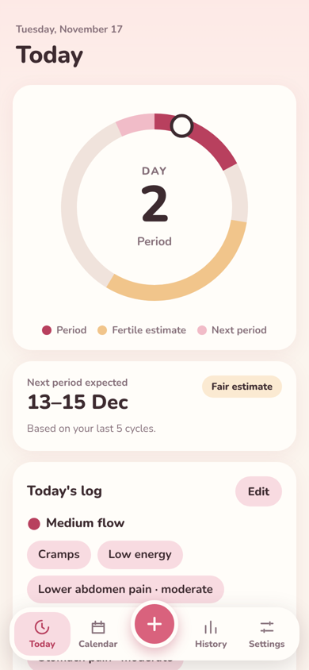
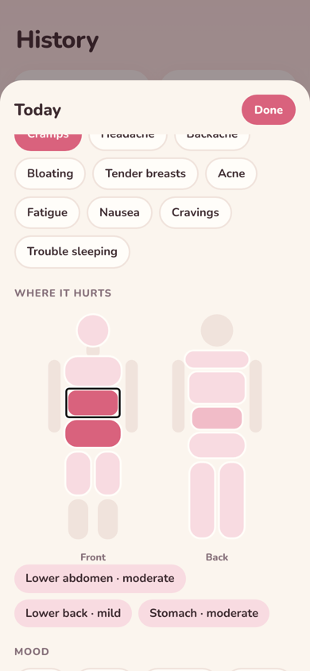
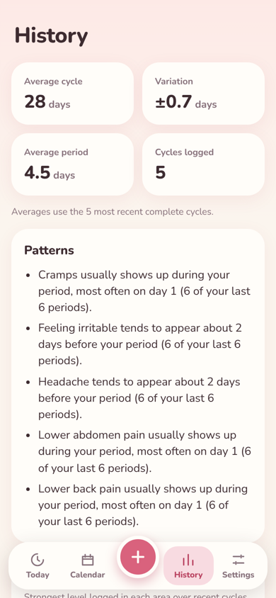
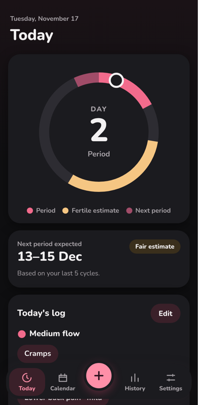
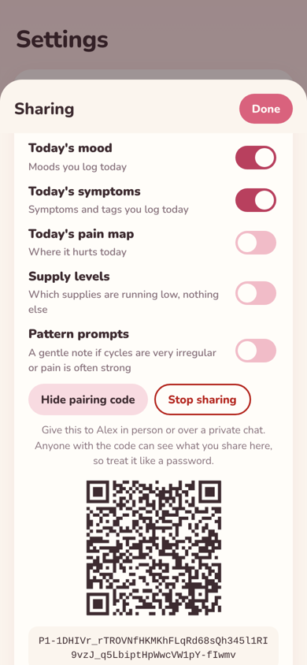
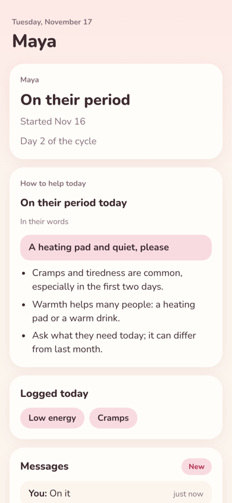
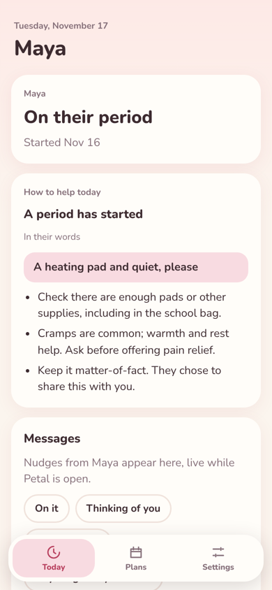
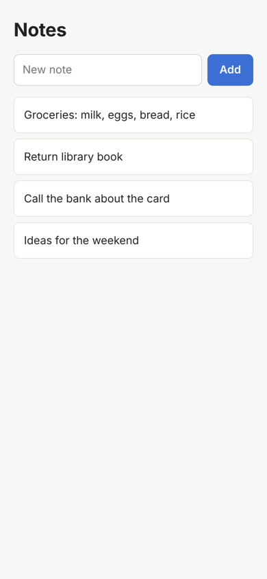

# Petal

A private, offline-first period tracker that installs from the browser like a native app. Cycle data stays on the device, encrypted with a PIN. Sharing with a partner, parent or caregiver is optional, end-to-end encrypted, and fully controlled by the person tracking.

**Live:** https://my-petal.vercel.app/

<p>
  
  
  
  
</p>

## Why

The most popular period trackers have been criticised for three things: sharing health data with third parties, putting basic features and the user's own history behind a paywall, and giving confident single-date predictions that break down for irregular cycles. Petal was designed around the opposite choices:

- **Private by architecture.** No account, no analytics, no ads. Logs live on the device. The sharing server only ever stores ciphertext it cannot read.
- **Everything free, including your data.** Export to PDF, CSV or a full backup at any time.
- **Honest predictions.** A date range with a confidence level that widens when cycles vary.

## Features

### Tracking
- **Cycle ring** showing today's cycle day, the period, the estimated fertile window and the expected next period
- **Day log** for flow, symptoms, mood, notes and **custom tags**
- **Pain map:** tap front and back body regions for mild, moderate or strong pain
- **Calendar** of logged periods, expected ranges and fertile estimates; any past day can be edited
- **Range-based predictions** with a confidence label, based on the six most recent cycles
- **Patterns:** finds symptoms, moods, tags or pain that recur at the same point in the cycle, such as "Headache tends to appear about 2 days before your period (4 of your last 4 periods)"
- **History:** average cycle and period length, variation, and every cycle as a bar
- **Supply tracker:** stock counts, a low-stock badge and an estimate of how many periods the stock will last
- **Late-period calm mode:** a reassuring explainer instead of an alarm when a period is past its range
- **New-to-periods mode** with short explainers and gentler wording
- **No-guilt logging:** no streaks or missed-day messages; past periods can be added in any order, and long gaps are left out of the averages
- **Period heads-up reminder** with discreet notification wording

### Sharing with a partner, parent or caregiver
- **Pairing** by code, link or QR code; each person gets a separate share that can be paused or stopped on its own
- **Seven per-person permissions:** cycle phase, predictions, mood, symptoms, pain map, supply levels and pattern prompts
- **Different defaults:** a parent starts with only "period started" and "period late"; a partner starts with phase, predictions, mood and symptoms
- **One-tap nudges** such as "Cramps are bad today" or "Could use a hug", with quick replies
- **Supporter app:** status, a "how to help today" card, her own notes in her words, heads-up alerts, plans that flag clashes with expected period days, and a private care checklist
- **Doctor prompts** for supporters, if allowed: a gentle note when cycles are very irregular or strong pain keeps recurring

<p>
  
  
  
</p>

### Privacy and app polish
- **PIN lock** that encrypts all data on the device and locks after a minute in the background
- **Discreet mode:** covers the screen when switching apps, and a **quick-hide** button that swaps Petal for a plain notes page (press and hold "Notes" to return)
- **Exports:** a one-page PDF summary for a doctor, a CSV of daily logs, and a full JSON backup with restore
- **Works offline** once opened a single time; the whole app is cached on the device
- **Update notice** when a new version has been published
- **Light and dark themes** that follow the phone's setting



## How the privacy works

**On the device.** All data is a single record in IndexedDB. With a PIN set, it is encrypted with AES-256-GCM using a key derived from the PIN with PBKDF2 (SHA-256, 310,000 iterations). The PIN itself is never stored; a wrong PIN simply fails to decrypt.

**When sharing.**
1. Each share gets its own random AES-256 key, a random room id and a write token, all created on the tracker's device.
2. The pairing code contains the room id and key. In a pairing link they sit after `#`, which browsers never send to a server.
3. The tracker's device builds the view for each supporter from that person's permissions, so anything not switched on never leaves the device. The view is encrypted before upload.
4. Supabase stores only ciphertext under random ids. Tables are closed to direct access; a small set of Postgres functions is the only way in, and only the holder of the write token (the tracker) can replace or delete a share.
5. Live updates use a Supabase Realtime broadcast that carries no data, only "something changed". The receiving device then fetches and decrypts. A 45-second poll covers missed signals.

Stopping a share deletes its room and messages from the server. A pairing code works like a password: anyone who has it can read that share until it is stopped.

## Tech stack

- **React 18 + TypeScript**, built with **Vite**
- **Web Crypto API** for all encryption, with no crypto libraries
- **IndexedDB** via `idb-keyval` for on-device storage
- **Service worker** for offline caching, updates and background reminders
- **Supabase** (Postgres functions and Realtime) for the encrypted sharing relay
- **jsPDF** for the doctor summary, loaded only when needed
- **Vitest** for unit tests
- No UI framework: hand-written CSS with design tokens

## Getting started

```
npm install
npm run dev
```

Open the address it prints. Tracking works straight away; sharing needs the setup below.

| Command | What it does |
|---|---|
| `npm run dev` | Development server |
| `npm test` | Unit tests for cycle maths, predictions, insights, encryption and sharing permissions |
| `npm run build` | Type-check and build to `dist/` |
| `npm run preview` | Serve the production build |

## Sharing setup (Supabase)

1. Create a project at supabase.com.
2. In **SQL Editor**, run the contents of `supabase/schema.sql`. Supabase warns that it contains destructive operations: these are the `revoke` statements that lock the tables, and the `delete` statements inside the "stop sharing" and message-trimming functions. Nothing existing is removed.
3. From **Project Settings → API Keys**, copy the **Project URL** and the **publishable key** (`sb_publishable_…`). Never use the secret key.
4. Copy `.env.example` to `.env` and fill in both values. The publishable key goes in `VITE_SUPABASE_ANON_KEY`.
5. In **Realtime → Settings**, keep **Allow public access** on for instant updates. Without it, updates arrive by polling.

## Deploying

The app is a static site, so any HTTPS host works. On Vercel: import the repository, keep the **Vite** preset, and add `VITE_SUPABASE_URL` and `VITE_SUPABASE_ANON_KEY` under **Environment Variables** before the first build. The values are built into the app, so redeploy after changing them.

To install on a phone, open the site and choose **Add to Home Screen** (Safari on iPhone) or **Install app** (Chrome on Android).

## Project structure

```
src/
  lib/
    cycle.ts          periods, cycles, statistics, range predictions
    insights.ts       patterns, pain summary, supplies, doctor prompts
    crypto.ts         PIN-based encryption at rest
    storage.ts        IndexedDB persistence
    export.ts         PDF, CSV and backup
    reminders.ts      period heads-up notifications
    pwa.ts            service worker registration and updates
    share/
      codec.ts        pairing codes and end-to-end encryption
      view.ts         builds each supporter's permitted view
      guidance.ts     "how to help today" content
      backend.ts      Supabase calls
  screens/            Today, Calendar, History, Settings
  supporter/          the app as a partner or parent sees it
  components/         cycle ring, pain map, day editor, sharing, discreet mode
  sync.ts             keeps shared views and messages up to date
  store.tsx           app state
public/sw.js          offline caching, updates, background reminders
supabase/schema.sql   the sharing backend
```

## Limitations and roadmap

- Alerts for supporters arrive while the app is open. Push notifications to a closed app (Supabase Edge Function plus Web Push) are planned.
- Background reminders work only where the browser supports periodic sync (installed Chrome on Android). Elsewhere they show when the app is opened.
- Data lives on one device. Use **Backup file** and **Restore from backup** to move it.

## Disclaimer

Petal gives estimates, not medical advice, and is not a method of contraception.
